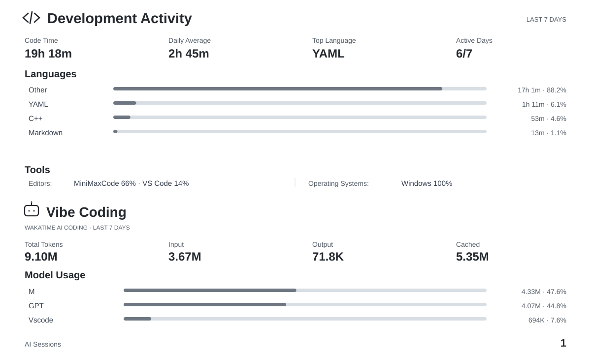

## Hi there 👋

This is **zyzh0**! And this is my [personal blog](https://blog.zyzh20021020.cn)

成分复杂，做过单片机，画过PCB，Linux主力用户，写了好几年Python，但是之后想做HPC🤔

### 最近摸的🐟

<picture>
  <source media="(prefers-color-scheme: dark)" srcset="assets/wakatime-dashboard-dark.svg" />
  <source media="(prefers-color-scheme: light)" srcset="assets/wakatime-dashboard-light.svg" />
  
</picture>

<picture>
  <source media="(prefers-color-scheme: dark)" srcset="https://github-readme-stats-zyzh2002s-projects.vercel.app/api?username=zyzh2002&amp;theme=github_dark" />
  <source media="(prefers-color-scheme: light)" srcset="https://github-readme-stats-zyzh2002s-projects.vercel.app/api?username=zyzh2002&amp;theme=default" />
  
</picture>
<picture>
  <source media="(prefers-color-scheme: dark)" srcset="https://github-readme-stats-zyzh2002s-projects.vercel.app/api/top-langs?username=zyzh2002&amp;layout=compact&amp;langs_count=8&amp;hide=Jupyter%20Notebook&amp;card_width=320&amp;theme=github_dark" />
  <source media="(prefers-color-scheme: light)" srcset="https://github-readme-stats-zyzh2002s-projects.vercel.app/api/top-langs?username=zyzh2002&amp;layout=compact&amp;langs_count=8&amp;hide=Jupyter%20Notebook&amp;card_width=320&amp;theme=default" />
  
</picture>

<picture align="center">
  <source media="(prefers-color-scheme: dark)" srcset="assets/github-snake-dark.svg" />
  <source media="(prefers-color-scheme: light)" srcset="assets/github-snake.svg" />
  
</picture>
